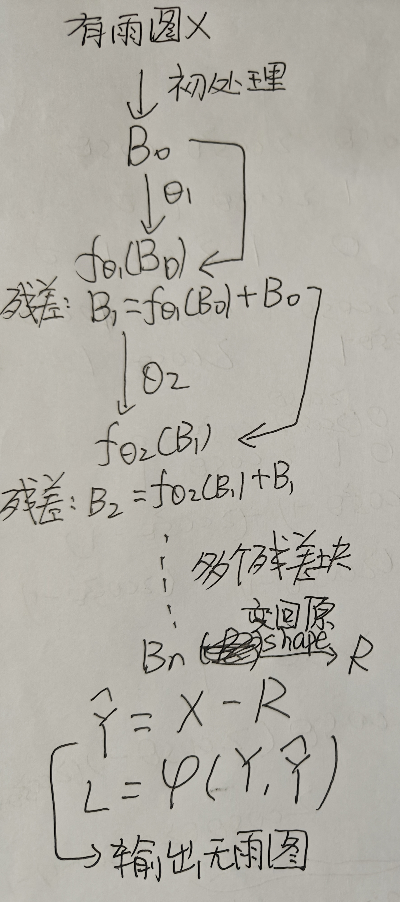

# Part1—任务一

## 我们应该让模型学习什么

### 对于如何去雨，我们主要有两种思路

1. 端到端直接映射：

   直接让模型学习一个映射 $F$ ，做到对于输入的有雨图 $X$ ，直接输出无雨图 $\hat{Y}$

$$
\hat{Y} = F(X)
$$

2. 残差学习:

   网络只输出**雨层** $R$，最后的减法由网络外部完成

$$
R = F_\theta(X), \qquad \hat{Y} = X - R
$$

### 应该选什么

对于去雨这种任务2是更好的选择

1. **雨是稀疏的**一张 $128\times128$​​ 的图有 16384 个像素位置

   雨丝很细，是白色的细小像素，通常只覆盖**很少**的像素

   也就意味着我们的输入图与输出图的差异像素其实不是很多

如果用方案一，原图的每个像素都要经过网络，最后的生成图即使没雨的地方也要经过网络计算重新生成

而用方案二，在无雨的地方正确答案就是 $R = 0$​ ，网络只要学会"**没雨的地方输出 0**"，任务就退化成"找出稀疏的异常"

换句话说，雨这一特征是典型的稀疏特征，找出异常的地方来本身工作量少，也相对容易

2. $R = 0$  是一个好的起点

   如果用方案一，那么初始输出是一堆随机噪声，网络在逐步减小与目标图的误差时，学习规律

   而选用方案二，我们可以直接将 $R = 0$ 初始化为0，即开始时认为没异常，在寻找过程中发现异常

**方案2让模型从一个已经"合理"的起点出发**："我什么都不改"至少不会比输入更差
方案1的起点是纯噪声，起点初始就离得远

3. **一定程度上减少梯度衰减的问题**

以三个残差块为例，这里忽略Relu，池化等操作，简化示例，不是真实模型：

$$
B_1 = f_{\theta_1}(B_0) + B_0
$$

$$
B_2 = f_{\theta_2}(B_1) + B_1
$$

$$
B_3 = f_{\theta_3}(B_2) + B_2
$$

$$
\text{令 } R = B_3
$$

$$
\hat{Y} = X - R
$$

$$
L = \varphi(\hat{Y}, Y)
$$

$$
\frac{\partial L}{\partial \theta_2} = \frac{\partial L}{\partial \hat{Y}} \cdot \frac{\partial \hat{Y}}{\partial R} \cdot \frac{\partial R}{\partial B_2} \cdot \frac{\partial B_2}{\partial \theta_2}
$$

而有：

$$
\frac{\partial R}{\partial B_2} = \frac{\partial f_{\theta_3}(B_2)}{\partial B_2} + I
$$

也就是$`\frac{\partial f_{\theta_3}(B_2)}{\partial B_2}`$这一项梯度小的时候，有I作为缓冲，使得梯度绝对值小于1的情况减少，一定程度上缓解梯度衰减的问题，提高面对梯度衰减的问题的鲁棒性，这也使提高模型层数有了可能

## 模型应该长啥样

思路：输入图应该先进行处理，变成一个易于进行残差学习的多通道图像

然后经过多个残差块，最后变回原来的shape，得到 $R$,

用$`\hat{Y} = X - R`$输出图像 $`L = \varphi(\hat{Y}, Y)`$来梯度下降

图片展示残差块之间的链接，省略Relu步骤，$\theta$​ 代表内部的卷积，池化等操作（**极草图**）：

## **附加问题**

### **模型如何分辨谁是雨丝**

**一条线是分不清的，但"一整张图上的线"能分清**

模型区分真正的雨和其他像雨的结构靠的并不是单一的像素，而是从雨层的分布中提取到雨层的规律性特征（**上下文与群体统计）**：

|                  | 雨丝                                                         | 电线 / 栏杆 / 建筑边缘             |
| ---------------- | ------------------------------------------------------------ | ---------------------------------- |
| **数量**         | **大量**（几十到几百条）                                     | 少数几根                           |
| **方向一致性**   | **几乎全部同向**（同一次降雨、同一阵风）                     | 各有各的方向，或彼此垂直           |
| **分布**         | **随机、均匀铺满**                                           | 按结构排列（等距、平行、有支撑点） |
| **连续性**       | 每条**独立**，不连接、不交汇                                 | 有连接点、有转角、形成网           |
| **与场景的关系** | **与场景弱相关**（草地、天空、建筑上都一样下），真正决定性影响的是风，温度等气象特征 | 和场景结构对齐（沿屋檐、沿路面）   |
| **粗细变化**     | 随远近连续变化，但**同类雨丝统计一致**                       | 无明显规律                         |

**判别依据是"群体模式"**:

**这个区域里有一大批方向一致、随机分布、半透明的细长亮线**推出：

**这是雨**

### **模型还有可能复原出原来的物体吗**

**复原与重建是不一样的**：

雨层遮挡的图像在没有外部信息的情况下已经丢失被遮挡的内容，**信息不可能凭空产生**，我们只能预测（**重建**）：

我们可以通过周围像素以及局部区域的像素统计值进行合理的预测，从而补全被雨层遮盖的地方，重建图像，达到视觉上“复原”的效果
