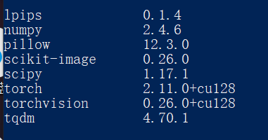
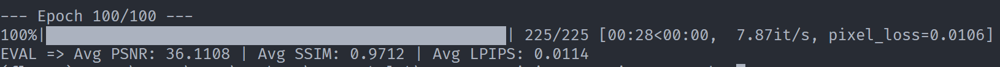
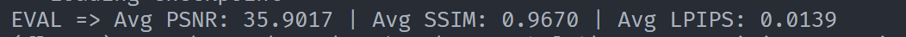
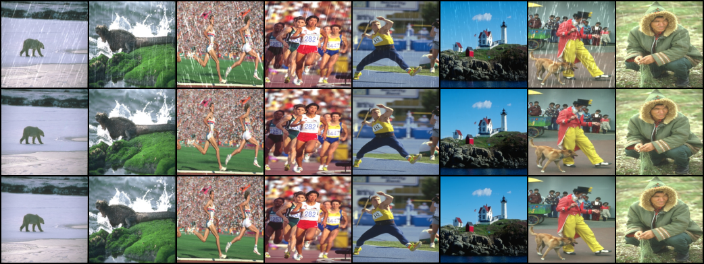

# Part1———任务三

## 环境搭建：小菜一碟

已安装，这里列出对应包的版本（安装完的终端清掉了，只能拍这个了）：



## 实现一个简单的模型

### 代码如下

```python
import torch
import torch.nn as nn
import torch.nn.functional as F

class ResidualBlock(nn.Module):
    def __init__(self, channels=64):
        super().__init__()
        self.body = nn.Sequential(
            nn.Conv2d(channels,channels,kernel_size=3,stride=1,padding=1,bias=False),
            nn.InstanceNorm2d(channels),
            nn.ReLU(inplace=True),
            nn.Conv2d(channels,channels,kernel_size=3,stride=1,padding=1,bias=False),
            nn.InstanceNorm2d(channels),
        )

    def forward(self, x):
        y = self.body(x)
        return F.relu(x + y)      

class BaselineNet(nn.Module):
    """8 个残差块的 ResNet"""
    def __init__(self, in_channels=3, out_channels=3, channels=64, num_blocks=8):
        super().__init__()
        self.head = nn.Sequential(
            nn.Conv2d(in_channels,channels, kernel_size=3, stride=1, padding=1),
            nn.ReLU(inplace=True),    
        )

        self.body = nn.Sequential(*[ResidualBlock(channels) for _ in range(num_blocks)])
             
        self.tail = nn.Conv2d(channels,out_channels,kernel_size=3,stride=1,padding=1)  
        # tail 零初始化
        nn.init.zeros_(self.tail.weight)
        nn.init.zeros_(self.tail.bias)

    def forward(self, x):
        step1 = self.head(x)
        step2 = self.body(step1)
        rain = self.tail(step2)
        out = x - rain
        return out
```

### 几种方案

1. **空洞卷积**：

   卷积核里插"空"， $3\times3$  的核等效  $5\times5$  ， $7\times7$  感受野增长，调整分辨率，做到特征图边长不变，即**分辨率不变**

   **代价：**

   由于卷积核采样时插空了，多层空洞卷积叠在一起，有的像素可能采样次数少甚至从未采样（采样稀疏）

2. **U-Net**：

   先下采样扩大感受野（编码），再上采样恢复分辨率（解码），中间用**跳跃连接**把浅层细节接回去

   **代价**：

   结构复杂，多了解码器，会有更多参数

3. **多尺度分支**：

   多尺度分支指**并行地用不同"尺度"提取特征，再融合**

   这里的"尺度"可以指感受野大小（不同 kernel/dilation），分辨率高低、或不同粒度的特征

   例如以kernel size 并行：

   ```python
   self.b1 = nn.Conv2d(channels, channels//4, 3, padding=1)
   self.b2 = nn.Conv2d(channels, channels//4, 5, padding=2)
   self.b3 = nn.Conv2d(channels, channels//4, 7, padding=3)
   out = torch.cat([self.b1(x), self.b2(x), self.b3(x)], dim=1)
   ```

4. 深层网络梯度消失、训练困难的问题残差连接本身就能缓解，选择适合任务的优化器，损失函数，学习率调度器也能缓解

## 这个代码是什么意思

### 运行结果

运行命令：

```bash
python main.py --data_dir "./data/Rain200L" --model baseline --mode train --epochs 100
```

第一百轮的结果：



测试结果：



compare图：



训练最后几轮的数据：

| Epoch   | PSNR        | SSIM   | LPIPS  | pixel_loss |
| ------- | ----------- | ------ | ------ | ---------- |
| 95      | 36.0960     | 0.9706 | 0.0110 | 0.00787    |
| 96      | **36.1939** | 0.9712 | 0.0114 | 0.00802    |
| 97      | 36.1827     | 0.9712 | 0.0116 | 0.00871    |
| 98      | 36.1771     | 0.9701 | 0.0117 | 0.00765    |
| 99      | 36.0470     | 0.9710 | 0.0117 | 0.00808    |
| **100** | 36.1108     | 0.9712 | 0.0114 | 0.01016    |

可以看出在96~98轮差不多到顶了

### 学到的新语法

1. tqdm添加可视化的进度条：

   ```python
   loop = tqdm(loader, leave=True)
   # loader 要是个可迭代对象
   ```

   对于可迭代对象，显示一个当前迭代轮数与总共要迭代轮数百分比的进度条

2. **命令行参数设置**：

   引入argparse包实现

   ```python
   parser = argparse.ArgumentParser(description="Deraining Model Training")
   # ArgumentParser,一个解析器类
   # 实例化了一个叫做 parser 的对象,用于注册与传入命令行参数
   # description的输入字符串在运行python main.py -h下显示
   parser.add_argument("--data_dir", type=str, required=True, help="Path to the dataset")
   # 增加可传入的参数，data_dir是参数名，后面的是对参数的特征要求
   # type=str 表示该参数只接受字符串
   # required=True 表示该参数必填
   # help="Path to the dataset" 用于展示 -h后显示的消息
   parser.add_argument("--model", type=str, default="baseline", choices=["baseline", "unet"], help="Model to use")
   # default="baseline" 表示未填入时的默认值
   # choices=["baseline", "unet"] 表示参数仅能接收在list中的值
   
   # 用法：
   # 通常放在一个函数里：
   def get_args():
       parser = argparse.ArgumentParser(description="Deraining Model Training")
       # 省略
       return parser.parse_args()
   # 命令行填入的参数保存在一个列表中，使用parser.parse_args 方法返回存储参数的 argparse.Namespace（结构像字典）
   
   args = get_args()
   # 访问值的时候用args.参数名
   ```

3. nn.InstanceNorm2d(实例归一化):

   针对**单张图的单个通道**算均值和方差

   ```python
   nn.InstanceNorm2d(num_features)
   # num_features为必填参数，表示要计算的图的通道数，其他参数有默认值
   ```

### 替换函数

具体实现如下：

```python
def calculate_psnr(img1, img2, data_range=1.0): 
    img1_trans = img1.astype(np.float64)
    img2_trans = img2.astype(np.float64)
    mse = np.mean((img1_trans - img2_trans) ** 2)
    if mse == 0:
        return float('inf')         
    return 10 * math.log10((data_range **2) /mse)
```


  


