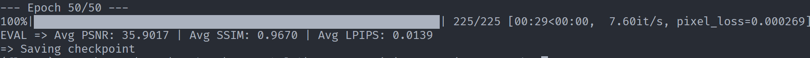
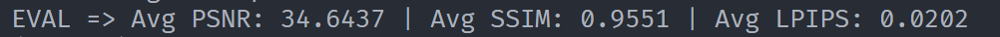
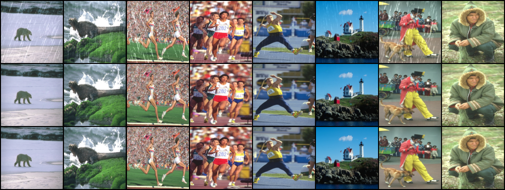

# Part2—第一部分—任务二

## 模型结构

```python
import torch
import torch.nn as nn
import torch.nn.functional as F

class ResidualBlock(nn.Module):
    def __init__(self, channels=64):
        super().__init__()
        self.body = nn.Sequential(
            nn.Conv2d(channels,channels,kernel_size=3,stride=1,padding=1,bias=False),
            nn.InstanceNorm2d(channels),
            nn.ReLU(inplace=True),
            nn.Conv2d(channels,channels,kernel_size=3,stride=1,padding=1,bias=False),
            nn.InstanceNorm2d(channels),
        )

    def forward(self, x):
        y = self.body(x)
        return F.relu(x + y)

class DerainNet(nn.Module):
    def __init__(self,raw_channels=3,inter_channels=64,num_blocks=8):
        super().__init__()
        self.head = nn.Conv2d(raw_channels,inter_channels,kernel_size=3,stride=1,padding=1,bias=False)
        self.pool_half = nn.MaxPool2d(kernel_size=2,stride=2)
        self.pool_quarter = nn.MaxPool2d(kernel_size=4,stride=4)
        self.back_double = nn.ConvTranspose2d(inter_channels,inter_channels,kernel_size=2,stride=2)
        self.back_four = nn.ConvTranspose2d(inter_channels,inter_channels,kernel_size=4,stride=4)
        self.tail = nn.Sequential(
            nn.Conv2d(inter_channels * 3,inter_channels * 3,kernel_size=3,stride=1,padding=1,bias=False),
            nn.InstanceNorm2d(inter_channels * 3),
            nn.ReLU(inplace=True),
            nn.Conv2d(inter_channels * 3, raw_channels,kernel_size=3,stride=1,padding=1),
        )
        
        nn.init.zeros_(self.tail[-1].weight)
        nn.init.zeros_(self.tail[-1].bias)
        # 三个分支用不同的残差参数
        self.rest_full = nn.Sequential(*[ResidualBlock(channels=64) for _ in range(num_blocks)])
        self.rest_half = nn.Sequential(*[ResidualBlock(channels=64) for _ in range(num_blocks)])
        self.rest_quarter = nn.Sequential(*[ResidualBlock(channels=64) for _ in range(num_blocks)])
    def forward(self,x):
        x_0 = self.head(x)

        h_1 = x_0
        x_1 = self.rest_full(h_1) + h_1

        h_2 = self.pool_half(x_0)
        x_2 = self.back_double(self.rest_half(h_2) + h_2 )

        h_3 = self.pool_quarter(x_0)
        x_3 = self.back_four(self.rest_quarter(h_3) + h_3 )

        inter = torch.cat([x_1,x_2,x_3], dim= 1)
        rain = self.tail(inter)
        return x - rain
```

## 结果

第50轮的指标：



测试指标：



图片compare(epoch = 50)：



## 思考和学习

### 什么是下采样和上采样

1. 下采样是指让特征图的空间尺寸变小，同时（通常）让通道数变多这一过程

   下采样可以使感受野扩大，但是会丢失部分空间细节

2. 上采样是指让特征图的空间尺寸变大，恢复回原始分辨率这一过程（与下采样相对）

   下采样使用**`ConvTranspose2d`**（转置卷积）这一操作，把图像边长大小扩大

### Concat（拼接）

新的操作，**沿指定维度把多个张量"并排接起来"，不改变其余维度的尺寸**

```python
inter = torch.cat([x_1, x_2, x_3], dim=1)
#  (C,128,128) →  (3C, 128, 128)
```

其中dim指定要拼接的通道维，但要求除拼接维度外的维度数据量对应相同

**为什么分支之间用 Concat 而不是直接 Add**：

直接add是把shape相同的张量对应位置直接加到一起

而三个分支代表**不同尺度**的特征，如果直接 `Add`，就强行要求它们"在同一位置表达信息"，会互相干扰

**`Concat` 让三种尺度并排存在，由后续卷积自己学习**

### 为什么 DerainNet 要先下采样后上采样

因为我们有个根本矛盾：

| 需求                                     | 要做什么                    | 副作用            |
| ---------------------------------------- | --------------------------- | ----------------- |
| **要看得远**（判断一条雨丝是否贯穿全图） | 扩大感受野 → 下采样或堆深层 | 丢细节 / 训练困难 |
| **要输出清楚**（每个像素都要准）         | 保持原分辨率                | 感受野不够        |

DerainNet采用分支并行的模型结构：

对于每个分支，我们先扩大感受野，缩小图片，**提取语义等抽象信息**

而这一步就是下采样，得来了**全局理解**

**去雨的输出必须是逐像素的、与输入同尺寸的结果**

即下采样得到的"全局理解"必须映射回原始坐标系**，**才能用于修改每一个像素

**所以必须上采样回** 128×128

### **`ConvTranspose2d`**（转置卷积）

与卷积相对，将图片由小扩大

基本参数：

```python
torch.nn.ConvTranspose2d(in_channels,out_channels,kernel_size,stride=1,padding=0,output_padding=0,bias=True)
```

输出图像边长公式：

```python
H_out = (H_in - 1) * stride - 2 * padding + output_padding + 1
```

具体操作：

与卷积相反，卷积是卷积核上面的数与扫过窗口的对应数相乘再相加，得到一个数

而转置卷积是把一个数与卷积核上面的数对应相乘，得到多个数，从而扩大图片


