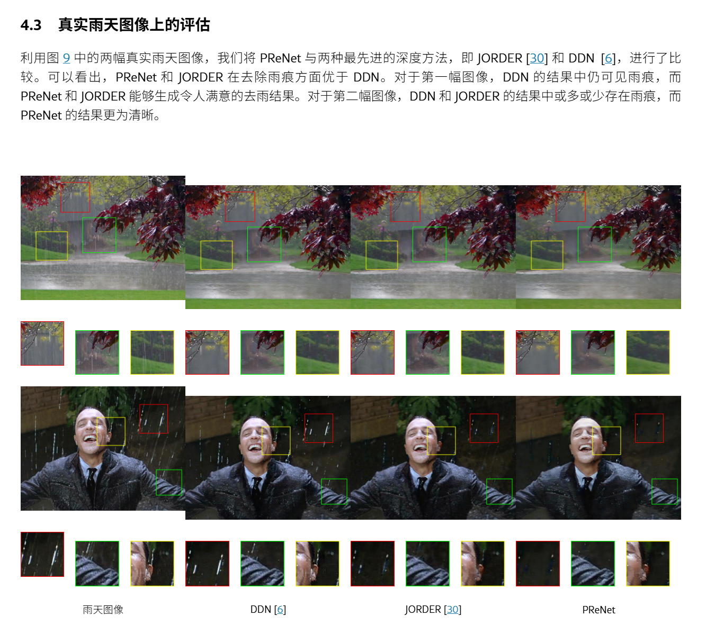
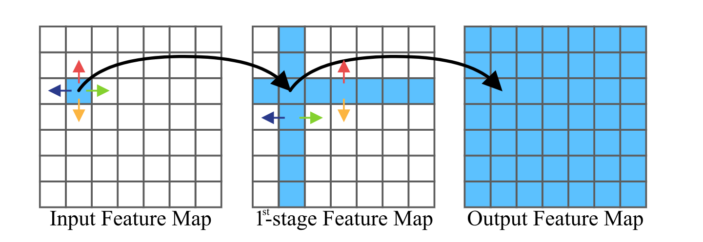
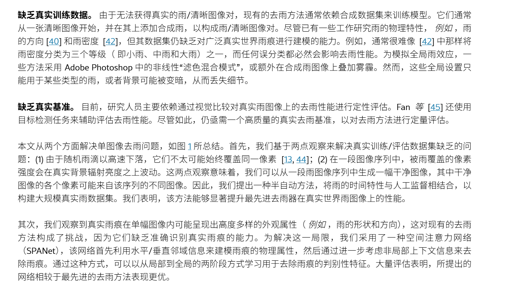
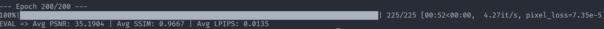
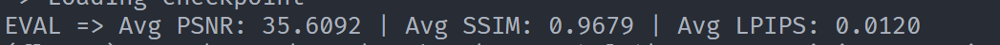
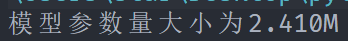
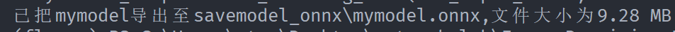
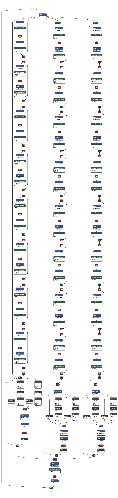

# Part2—第一部分—附加一

## 看论文

**简单的看了一下三篇论文**：

### PRN 和 PReNet（CVPR 2019）

#### 大概理解

链接的论文给了两个模型，一个PRN ，一个PReNet

这个论文作者说：

> Along with the deraining performance improvement of deep networks, their structures and learning become more and more complicated and diverse, making it difficult to analyze the contribution of various network modules when developing new deraining networks. To handle this issue, this paper provides a better and simpler baseline deraining network by considering network architecture, input and output, and loss functions

> 随着深度网络去雨性能的提升，其结构和学习变得越来越复杂多样，导致在开发新的去雨网络时难以分析各种网络模块的贡献。为解决这一问题，本文从网络架构、输入输出和损失函数三个方面出发，提供了一个更好且更简单的基线去雨网络

作者想解决：**给领域一个可分析的简单基线**

os：这确实很重要，提供对比基线

**核心思路**：

**把一个很浅的 ResNet 反复用多次**（多阶段）

**PRN**：

```
阶段 1:  y₀ = B（有雨图）
         x₁ = ResNet( [y₀, B] )        ← 输入 6 通道
         y₁ = y₀ - x₁                    ← 去雨
阶段 2:  x₂ = ResNet( [y₁, B] )
         y₂ = y₁ - x₂
...
阶段 6:  y₆ = y₅ - x₆                    ← 最终输出
```

**PReNet**：

PReNet = PRN + ConvLSTM

ConvLSTM层引入一个循环状态 𝐬^t^

将每个阶段的输出与循环状态 𝐬^t^ 一同输入一个卷积层，再输入下一阶段（具体数学原理还是太复杂了）

#### 启示：

1. **不一定要发明新的计算指标公式，新的操作函数**，复用浅网络其实有时也能取得有效的结果

2. **多阶段要防信息丢失**，如同残差网络中，将head处理后的张量加回去，即每阶段拼原始输入

3. 参数不是越大越好，合适才是真理，先进的方法不一定效果好，正如论文原文：

   

   

### SPANet（CVPR 2019）

#### 大概理解

**雨丝是有方向的长条，所以用"沿 4 个方向扫"的注意力来捕捉它**



#### 启示

1. 论文在开篇指出两个问题：

   

   合成雨的建模不足，和真实雨差很远，真实雨图和无雨图**无法同时拍摄**，导致评估不客观

   为了解决这个问题，他们改进数据集，使用半自动构造方法

       1. 对同一场景拍一段连续视频（雨在动、背景不动）
       2. 多帧信息能分离静态背景和瞬态雨丝
       3. 半自动 + 人工监督，生成一张"无雨"的干净图

   即：

   **数据集可能比模型更重要**（好的数据集很大程度决定模型的训练好坏）

2. 抓住雨的方向特征（**利用任务的先验结构**）

   雨丝有方向，就用方向性模块，比通用卷积更对口

### MPRNet（CVPR 2021）

#### 大概理解

使用**多阶段渐进修复**：

**每个阶段用"编码器-解码器（抓全局）+ 高分辨率分支（保细节）"双路结构**

同时引入逐像素自适应，决定图像不同地方要修多少的程度

#### 启发

使用编码器-解码器 + 高分辨率分支这样的双路结构

同时使用多阶段的模型结构

## 方法总结

### 找文章

**找文章最关键的是弄清楚要什么和手里有什么线索，掌握丰富的网站**：

1. 弄清楚自己要什么领域，与什么相关，什么层次的论文

   **一篇已知的论文**还是**一个主题**

2. 线索的丰富程度决定用哪个网站、用什么查

   查一篇已知的论文有**DOI**，**标题**，**作者+年份+期刊** 很好查

   考虑在谷歌学术或 Web of Science 精确匹配，或者检索作者，年份，期刊

   如果是一个主题（比如去雨），去该主题所属领域权威的机构官方的期刊和官网对应板块查询，或者关键字搜索

3. 引用检索：

   论文结尾会有引用资料的链接，这往往是相关领域的文章

   如果想找一个模型或者概念的开创文章，可以通过引用链一层一层回溯

### 处理一篇文章

可以尝试使用专门训练用来学术翻译的ai翻译服务，翻译全文，了解大概

当然全靠ai翻译是不可靠的（**ai也可能会出现翻译问题**）

要精读时可以对重要部分看原文，查阅学术词汇

面对不会的尝试查资料，询问专业人士，或者向ai求助

较新的文章出现新的术语与概念最好不要只发概念词，**把上下文也要一同发过去**

### 渐进式训练

渐进式训练是指在训练过程中不使用一套恒定不变的参数，而是动态调整参数的训练范式

在图像修复领域渐进式训练通常指的是渐进增大 patch 的训练过程

先在小 patch 上训，逐步换成大 patch

patch：从原图裁剪的尺寸，相当于先训练局部图像，再慢慢扩大，训练整张图

而出题人从始至终用的原图大小固定

**这样做的好处**：

1. 小 patch 迭代快，梯度小，稳定，早期计算可以快速收敛，可以早期快速发现模型设计的缺陷和问题
2. 间接扩大数据集，每轮从不同位置裁，同一张图能提供多个不同样本

**劣势**：

1. 实现复杂，过程繁琐
2. 需要的超参数要实时调整适应更大的patch

**未来科研是否用**：

渐进式训练是一种高效的方法，但是不能滥用，也不能原版照抄已有文章的渐进式训练的超参数设置，需要考虑自身的时间，精力，训练的目的，要求，结果的精度要求等等因素

 

## 自己的模型

下面是自己设计的模型：

主要在之前的dedrainnet中加了丐版的4方向累积注意力机制

但是这样模型参数量已经达到了2.41M，在epoch=200，训练图片只有1800张的情况下可能会过拟合

```python
import torch
import torch.nn as nn
import torch.nn.functional as F

# 依旧残差块起手
class ResidualBlock(nn.Module):
        def __init__(self, channels=64):
            super().__init__()
            self.body = nn.Sequential(
                nn.Conv2d(channels, channels, kernel_size=3, stride=1, padding=1,bias=False),
                nn.InstanceNorm2d(channels),
                nn.ReLU(inplace=True),
                nn.Conv2d(channels, channels, kernel_size=3, stride=1, padding=1,bias=False),
                nn.InstanceNorm2d(channels),
            )

        def forward(self,x):
            y = self.body(x)
            return F.relu(x + y)


# 丐版的4方向累积注意力机制
class SPANet(nn.Module):
        def __init__(self,channels=64):
            super().__init__()
            self.conv1 = nn.Conv2d(channels * 4,channels,kernel_size=3,stride=1,padding=1)
            self.conv2 = nn.Conv2d(channels,1,kernel_size=3,stride=1,padding=1)
        def forward(self,x):
            right = torch.cumsum(x,dim=3)
            left = torch.cumsum(x.flip(3),dim=3).flip(3)
            down = torch.cumsum(x,dim=2)
            up = torch.cumsum(x.flip(2),dim=2).flip(2)    
            full = self.conv1(torch.cat([right,left,down,up],dim=1))
            a = torch.sigmoid(self.conv2(full))
            return x * (a + 1)       

class Mymodel(nn.Module):
        def __init__(self, raw_channels=3, inter_channels=64, num_blocks=8):
            super().__init__()
            # 初处理，把channels从3变成64
            self.head = nn.Conv2d(raw_channels,inter_channels, kernel_size=3, stride=1, padding=1)
            self.rest_full    = nn.Sequential(*[ResidualBlock(64) for _ in range(num_blocks)])
            self.rest_half    = nn.Sequential(*[ResidualBlock(64) for _ in range(num_blocks)])
            self.rest_quarter = nn.Sequential(*[ResidualBlock(64) for _ in range(num_blocks)])
            # 池化，造分支
            self.pool_half = nn.MaxPool2d(kernel_size=2,stride=2)
            self.pool_quarter = nn.MaxPool2d(kernel_size=4,stride=4)
            # 转置卷积，变回原图
            self.back_double = nn.ConvTranspose2d(inter_channels,inter_channels,kernel_size=2,stride=2)
            self.back_four = nn.ConvTranspose2d(inter_channels,inter_channels,kernel_size=4,stride=4)
            # 尾处理，把channels从64变成3
            self.tail = nn.Sequential(
                nn.Conv2d(inter_channels * 3,inter_channels,kernel_size=3,stride=1,padding=1,bias=False),
                nn.InstanceNorm2d(inter_channels),
                nn.ReLU(inplace=True),
                nn.Conv2d(inter_channels, raw_channels,kernel_size=3,stride=1,padding=1),
            )
            nn.init.zeros_(self.tail[-1].weight)
            nn.init.zeros_(self.tail[-1].bias)
            self.spa1 = SPANet()
            self.spa2 = SPANet()
            self.spa3 = SPANet()
        def forward(self,x):
            x_0 = self.head(x)

            h_1 = x_0
            b_1 = self.rest_full(h_1) + h_1
            x_1 = self.spa1(b_1)

            h_2 = self.pool_half(x_0)
            b_2 = self.back_double(self.rest_half(h_2) + h_2 )
            x_2 = self.spa2(b_2)

            h_3 = self.pool_quarter(x_0)
            b_3 = self.back_four(self.rest_quarter(h_3) + h_3 )
            x_3 = self.spa3(b_3)

            inter = torch.cat([x_1,x_2,x_3], dim= 1)
            rain = self.tail(inter)
            return x - rain
```

**训练指标**：

数据如下：



与之前的derainnet相比：


PSNR要差点，SSIM差不多，但是LPIPS要好一点（其实差不多）

**测试指标**：

mymodel：



derainnet：


其实mymodel更好些

## 简单的计算模型参数的代码

计算模型参数的代码：

```python
import os
import torch
from torch.utils.data import DataLoader
from models.mymodel import Mymodel
from dataset import DerainDataset

def main():
        device = torch.device("cpu")
        model = Mymodel().to(device).eval()
        root_dir = "./data/Rain200L"
        dataset = DerainDataset(root_dir,is_train=False)
        rainy, _, _ = next(iter(DataLoader(dataset,batch_size=1)))
        rainy = rainy.to(device)

        checkpoint_path = "savemodel_onnx"
        mymodel_onnx_path = os.path.join(checkpoint_path,"mymodel.onnx")
        os.makedirs(checkpoint_path,exist_ok=True)

        n = sum(p.numel() for p in model.parameters())
        print(f"模型参数量大小为{n / 1e6 :.3f}M")
        torch.onnx.export(model,rainy,mymodel_onnx_path,export_params=True,dynamo=False,
                         opset_version=17,input_names=["rainy"],output_names=["derain"],
                         dynamic_axes={
                            "rainy":{0:"batch",2:"height",3:"width"},
                            "derain":{0:"batch",2:"height",3:"width"}
                         },
                         )
        print(f"已把mymodel导出至{mymodel_onnx_path},文件大小为{os.path.getsize(mymodel_onnx_path) / (1024 ** 2):.2f} MB")

if __name__ == "__main__":
        main()                         

```

输出截图：





拖入网站：



## 为什么使用文中同样的架构或模块来优化模型反而不会提高，甚至降低点数？

**适合的才是最好的**

这个任务的训练集只有1800张图，不同模型架构训练集的“舒适区”不同（小了过拟合，多了欠拟合，时间也长）

除此之外，训练集的质量也很重要，正如SPANet论文中提到，合成雨的建模不足，和真实雨差很远，图像建模不好也会很大程度影响训练效果

而且不同模型所需的优化器、调度器也要对应进行合适的选择，采取渐进式和不采取训练效果也会不同

简而言之，不能只生搬硬套论文的模型结构，要提炼思想，基于自己的任务进行优化
