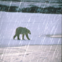
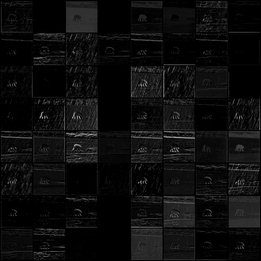
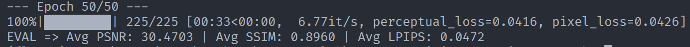
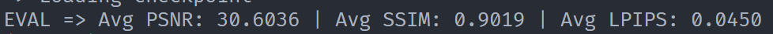
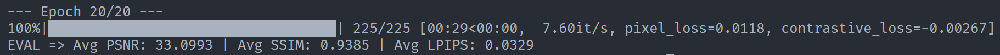
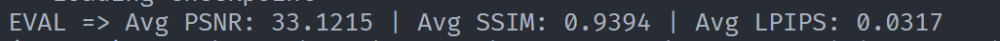

# Part2—第二部分

## 基于像素到底有什么不好？😟

### **仅仅是多使用了一个预训练模型，为什么 LPIPS 能够更好地衡量感知差异呢**🤔

传统指标（PNSR，SSIM）衡量的是**像素层面的差异**

PSNR 基于逐像素误差，SSIM 虽然引入了亮度、对比度和结构分量，但本质上仍依赖于低层统计量

但是**像素值接近不等于人眼看起来相似**，人眼敏感的不是一个一个的像素，而是局部的颜色，形状，纹理，整体的风格或者像更深层的语义，是综合的感知，可能对于某些变化不敏感，但是某些变化极小也会有所察觉

例如某些图片经过平移，翻转，对称或者改变局部像素值的变换，人眼看起来可能内容，风格差异不大，但是传统指标会大幅改变，某些在像素层面差异不大的失真（如局部纹理模糊），人眼却可能很敏感

而预训练模型提供了**一种与人类视觉感知更对齐的特征表示空间**

预训练模型在大量图像上学习到的特征，本身就编码了与视觉感知相关的规律，浅层特征对边缘、颜色、纹理敏感，深层特征对语义结构敏感

LPIPS比较两张图片在选中的不同层的差异，即LPIPS比较的是学习到的特征空间，所以能更好的衡量感知差异

### 训练好的网络起到了什么作用？

1. 充当特征提取器，**把像素映射到特征空间**，相当于把视觉上的感知差异编码为可计算，可对比的指标，便于衡量感知差异
2. 分层提取的特征图用于衡量不同层次的差异，综合起来衡量感知差异，更贴近人眼的感知

这里展示使用VGG19 0~4层处理后的可视化图像（变成多个灰度图）：

先是原图：



每个通道展开的灰度图：



原始的彩色照片变成了不同的灰度图

每个灰度图展示提取的不同特征图，有的提取了白色的雪地背景，有的突出了北极熊的轮廓，有的黑乎乎一团，但是有的地方很亮，比如北极熊的轮廓，雨的线条

### `perceptual_loss` 补全代码

```python
import torch 
import torch.nn as nn
from torchvision.models import vgg19, VGG19_Weights

class PerceptualLoss(nn.Module):
    def __init__(self):
        super().__init__()
        vgg = vgg19(weights = VGG19_Weights.IMAGENET1K_V1).features.eval()
        self.mean = torch.tensor([0.485, 0.456, 0.406]).view(1, 3, 1, 1)
        self.std = torch.tensor([0.229, 0.224, 0.225]).view(1, 3, 1, 1)
        self.criterion = nn.L1Loss()
        self.model = vgg[:35]
        for p in self.model.parameters():
            p.requires_grad = False

    def forward(self,generated, ground_truth):
        generated_normed = (generated - self.mean) / self.std
        ground_truth_normed = (ground_truth - self.mean) / self.std
        return self.criterion(self.model(generated_normed),self.model(ground_truth_normed))
```

使用如下main命令行参数：

```
python main.py --data_dir "./data/Rain200L" --model unet --mode train --epochs 50 --use_perceptual_loss --loss L2
```

epoch=50的结果：



测试结果：



## 你知道什么是向量吗？😊

1. 向量指一种同时有大小和方向的量，在ml中是一组有序的数字列表，比如一个人的特征（身高、体重、年龄）可以表示为一个三维向量

   而维度就是指这个向量包含多少个量，即特征的数量

2. 两种表示方法：

   1. 坐标表示法，两个向量对应位置的元素相乘，然后再把所有乘积加起来
   2. 几何表示法，两个向量的模长（长度）相乘，再乘以它们之间夹角的余弦值

   线性代数中，两个矩阵相乘就相当于把左矩阵分解成多个行向量，右矩阵分解成多个列向量，对应进行多个内积操作

3. 向量内积可以衡量两个向量的方向一致性

   余弦相似度就是将两个向量转化为方向不变的单位向量后的内积，运算上就是夹角的余弦值，取值范围为[-1,1]，可以衡量两个向量方向的一致性，越接近1越一致，越靠近-1相反程度越大

## 改造感知损失函数，使用特征做对比😏

### question1

建个空壳的easy_contrastive_loss.py，先把骨架搭好，在main里面导入：

```python
from losses.easy_contrastive_loss import EasyContrastiveLoss
```

在get_args里面加上控制easy_contrastive_loss是否启用和控制权重的命令行参数：

```python
parser.add_argument("--use_contrastive_loss", action="store_true", help="Use easy contrastive loss")
parser.add_argument("--lambda_contrastive", type=float, default=0.1, help="Weight for easy contrastive loss")
```

set_postfix可以显式传入关键字参数，也可以直接传入字典，这里改造成字典，简洁代码

```python
for _, (rainy, clean, _) in enumerate(loop):
        rainy, clean = rainy.to(device), clean.to(device)
        derained = model(rainy)
        pixel_loss = args.lambda_pixel * pixel_loss_fn(derained, clean)
        total_loss = pixel_loss
        stats = {pixel_loss:pixel_loss.item()}
        if args.use_perceptual_loss:
            p_loss = args.lambda_perceptual * perceptual_loss_fn(derained, clean)
            total_loss += p_loss
            stats[perceptual_loss] = perceptual_loss.item()
        if args.use_contrastive_loss:
            c_loss = args.lambda_contrastive * contrastive_loss_fn(derained, clean)
            total_loss += c_loss
            stats[contrastive_loss] = contrastive_loss.item()
        loop.set_postfix(stats)        
        optimizer.zero_grad()
        total_loss.backward()
        optimizer.step()
```

### question2

`AdaptiveAvgPool2d` 是 PyTorch 中的一个二维自适应平均池化层，参数为一个整数（代表正方形）或者一个二元组（可以为None，表示对应维度大小不变），输入形状：`(N, C, H_in, W_in)` 或 `(C, H_in, W_in)`，输出`(N, C, S0, S1)` 或 `(C, S0, S1)`， `S0` 和 `S1` 对应设置的 参数

其原理是对要改变的区域求平均，并修改

在这里可以将参数输入`（H，W）`，输出`(N,C,1,1)`的张量，再`flatten` 展平，变成N个向量

**easy_contrastive_loss**：

```python
from torchvision.models import vgg19, VGG19_Weights
import torch
import torch.nn as nn
import torch.nn.functional as F

class EasyContrastiveLoss(nn.Module):
    def __init__(self):
        super().__init__()
        vgg = vgg19(weights=VGG19_Weights.IMAGENET1K_V1).features.eval()
        self.register_buffer("mean",torch.tensor([0.485, 0.456, 0.406]).view(1, 3, 1, 1))
        self.register_buffer("std",torch.tensor([0.229, 0.224, 0.225]).view(1, 3, 1, 1))
        self.model = vgg[:35]
        for p in self.model.parameters():
          p.requires_grad = False
        self.pool = nn.AdaptiveAvgPool2d(1)
    def prepare(self,x):
        x_normed = (x - self.mean) / self.std
        x_feat = self.model(x_normed)
        out = self.pool(x_feat).flatten(1)
        return F.normalize(out,p=2,dim=1)
    def forward(self,generated,rainy,truth):
        generated = self.prepare(generated)
        rainy = self.prepare(rainy)
        truth = self.prepare(truth)
        cos1 = (generated * rainy).sum(dim=1).mean()
        cos2 = (generated * truth).sum(dim=1).mean()
        return (cos1 - cos2)

```

### question3

简单试试二十轮（不过多关注指标高低）：



测试：




