# Part2—第二部分—附加二附加三

## 附加二

### question1

因为不同任务要评估的对象不同，我们关心的结果不一样，所需的指标自然不一样，而且损失函数的构造决定了模型会往哪学，人为选择损失函数可以一定程度控制模型学习的方向，来迎合我们的目标

除此之外，不同损失函数的**性质不同**，有的梯度性质好，有的评价深度更深

如果用所有的损失函数，不同项的量级是不同的，量级大的会主导损失函数，主导模型的优化方向，这可以给每个项一个权重来放缩至同一量级来解决

但是加入太多的项仍然不是个好选择，在实际任务中，我们往往不知道权重选什么最好（尤其是多个权重互相影响的情况下），需要微调，而加入太多的项，意味着要微调的权重会变多，时间成本变大，而且带来的收益可能很小（边际递减），所以合适的选择是选几个在与该任务同类任务中表现较好的损失函数，即使加也是一个一个加，边加边调整，而不是一股脑**使用所有的损失函数**

### question2

1. 这些损失函数目标可能本质冲突，不存在"全都最优"的解，加权和只能找折中的解，而折中的解可能对每个目标都不够好，合起来互相拖后腿，效果变差
2. 多个损失函数可能会造就病态解，梯度相抵的意外区域，在这些区域模型可能会陷入停滞或者剧烈震荡，反而收敛慢，结果差
3. 多个损失函数加权本来就难以权衡各个权重的大小，选什么权重，结果是什么，往往是经验总结，具体任务真实效果有时难以预测，一旦选的不好，反而互相拖累，效果变差

### question3

如同我们对向量归一化变成单位向量一样，我们对每一项的梯度做归一化（例如L2范数），变成同一个范围，再由权重这个超参数控制归一化梯度贡献比例，这样就消除了其本身大小和数量级的影响，发挥的作用与超参数有关

## 附加三

### 学习总结

#### video1

主要讲了MOCO这篇论文（Momentum Contrast for Unsupervised Visual Representation Learning），了解到了以下的内容：

1. 对比学习的基本概念：

   对比学习通过构建正样本对和负样本对，**让相似的样本在表征空间中靠近，让不相似的样本远离**

   这里的正样本就是在特征空间中相似的样本，负样本就是在特征空间中不相似的样本

   损失函数通过鼓励模型把正样本对拉近、负样本对推远来更新模型参数

   正样本和负样本的选择很灵活（吃想象力的）

   **比如图像领域可以这样构造**：

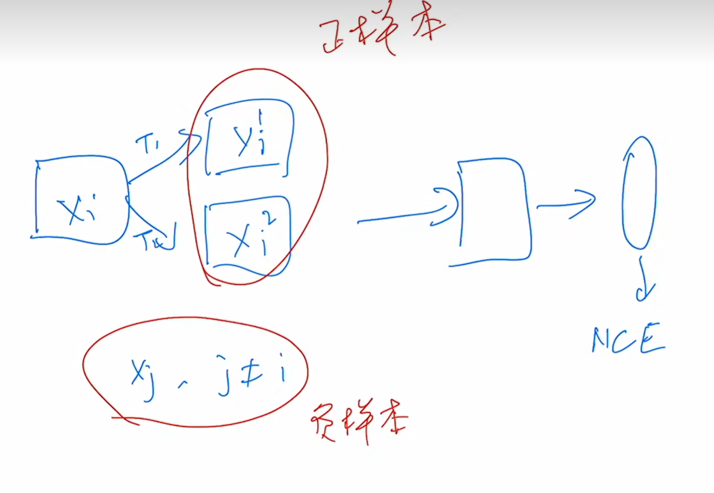

核心思路就是一个batch里同一张图片经过两个不同的变换器后的图像在特征空间的映射应当是接近的，而batch里其他的图像在特征空间的映射应当是远离的，可以通过这来构建正样本对和负样本对

也可以多个：

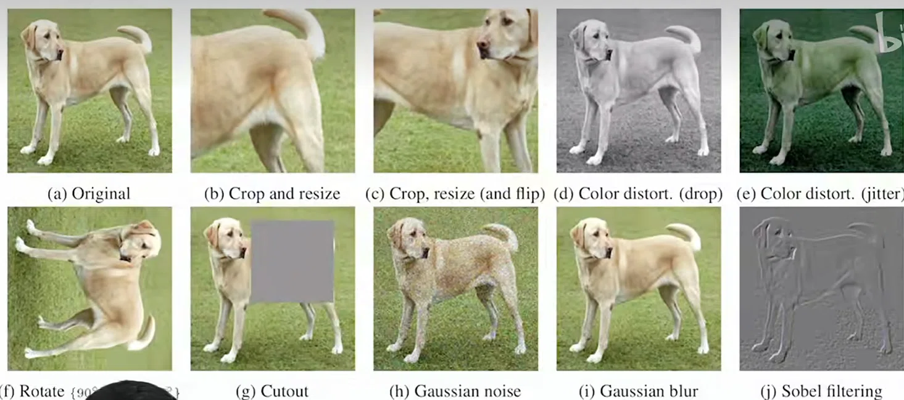

**还有其他意想不到的思路**（让我抠破脑袋都想不出来）：

一个图片的不同空间视角（看的方向）可以是正样本，不同图片之间是负样本

一个图片的不同处理（RGB图，深度图等等）可以是正样本，不同图片之间是负样本

一个视频相邻的两帧可以是正样本，不相邻的是负样本

2. MOCO论文的个人理解：

   **MOCO把之前对比学习论文的方法抽象总结为构建动态字典，在字典中找键的过程**

   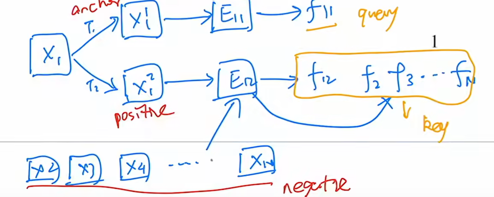

   正样本与其他的负样本被收录于一个字典中，而模型的工作就是预测哪个键是最接近锚点经过编码器得到的表征向量（query向量），并把它选出来

   **MOCO提出这个字典应当满足**：

   1. **字典尽可能大**，这样视觉特征提取的更丰富，模型更可能学到能真正区分正样本和负样本的特征
   2. **应保持一致性**，即字典中的键应由相同或相似的编码器表示，从而使其与查询的比较保持一致，否则不同的编码器带来隐式的差异改变原来的特征空间，可能导致分布偏移，难以区分，甚至某些负样本与query向量反而更接近

   接着提出对比学习很多任务面临的问题：往往以上两点无法兼得（至少为以上一个方面受限）

   MOCO把以往的模型提炼为两种架构：

   1. end to end

      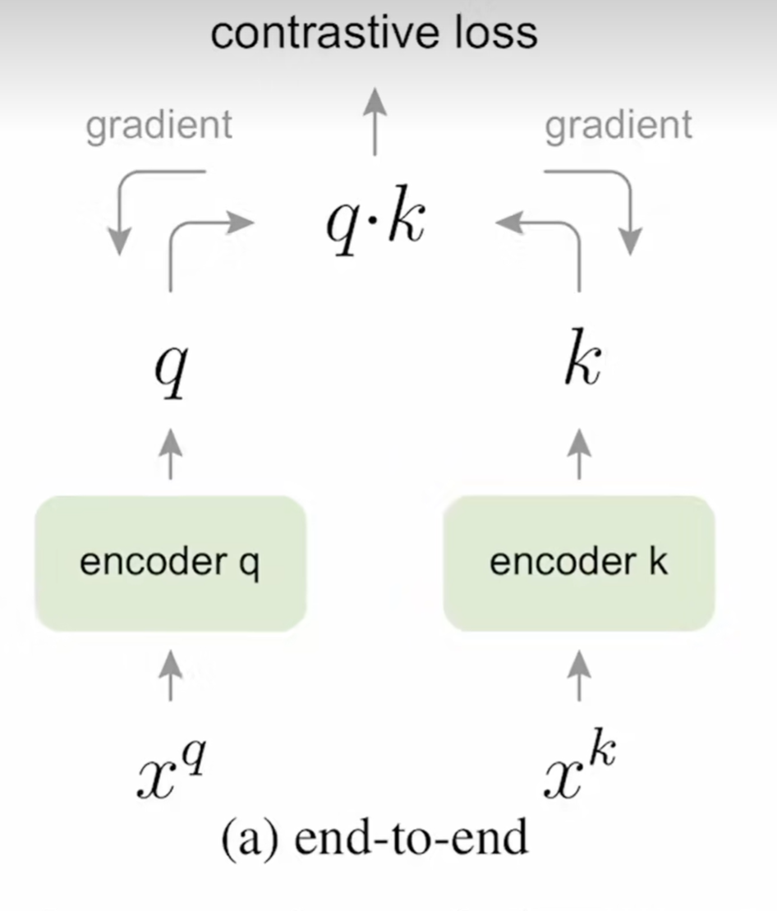
      把整个batch里的图片放进编码器，正样本和负样本在整个batch里面提取，这样字典的大小会受到batch size的影响，而batch size变大，计算量会大幅提升（N^2^量级)，受限于字典的大小
   
   2. memory bank

      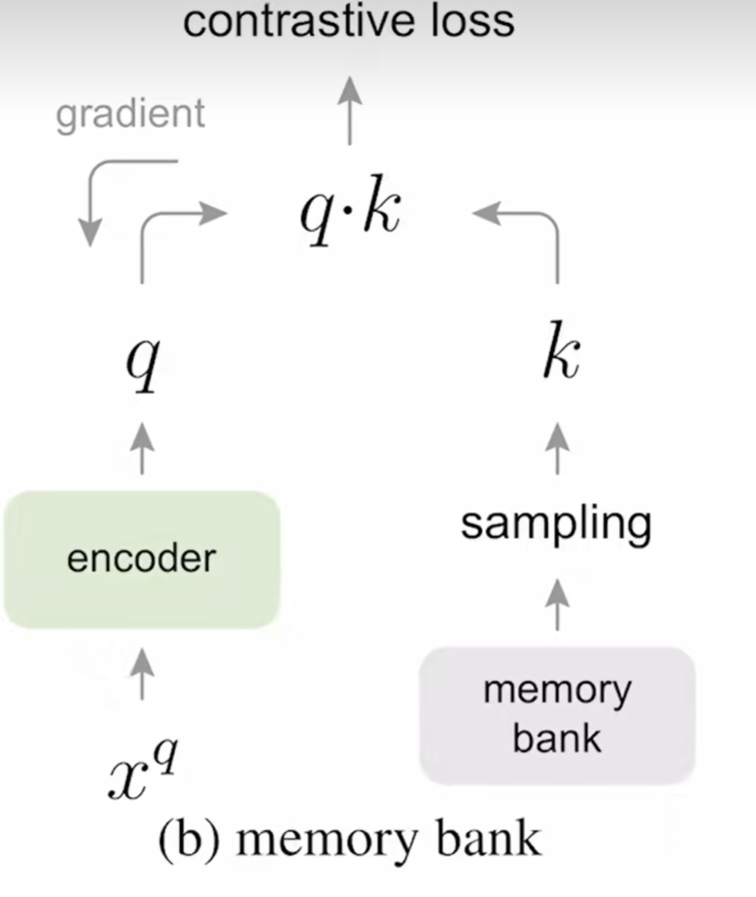

      memory bank里面提前存放好训练集所有图通过解码器提取的特征向量，在对比时随机取样来与q算损失函数，更新参数后，把最新的特征 q直接覆盖写入到 memory bank 中对应 x^q^的位置，但是因为是一次一次更新的，在下一个epoch开始时编码器经过多轮的更新，qurry的特征与此时记忆库里的key相差很大，一致性就变差了

   而MOCO进行了改进：

   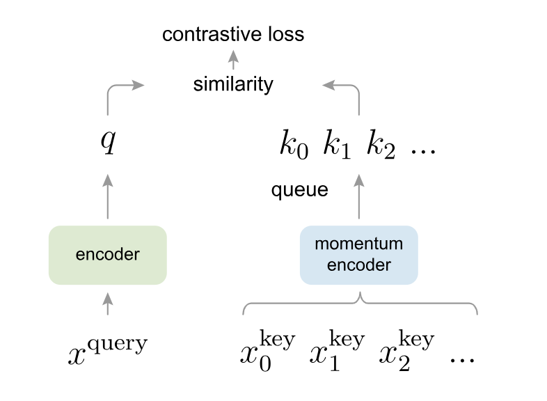

   首先在字典那边加入一个动量编码器：

   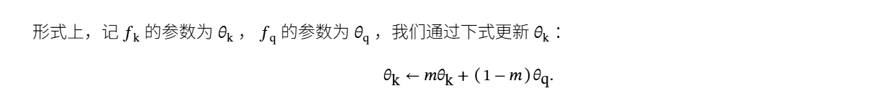

   初始化使动量编码器与编码器参数相同，后面更新时，把m拉的很大（比如0.9999），即参数有0.9999来自于上一次更新的动量编码器，只有0.0001接收编码器的参数更新，这样动量编码器就更新的很慢，一致性就能保持得比较好
   
   同时使用队列的结构保存字典，每次更新时让历史最远的特征向量出列，让新的特征向量进来，相当于解耦了batch size与字典大小的关系，字典大小变成队列长度上限与batch size无关的超参数
   
   即同时满足了字典大小与一致性的要求
   
   
   
   同时MOCO使用了 InfoNCE 损失：
   
   
   $$
   \mathcal{L}_{\text{InfoNCE}} = -\log \frac{\exp(\text{sim}(q, k^+)/\tau)}{\sum_{i=0}^{K} \exp(\text{sim}(q, k_i)/\tau)}
   $$
   
   
   其中q是锚点的特征向量，k^+^是与q匹配的正样本特征向量，$k^{+}$ 是包含 1 个正样本和 K个负样本的特征向量集合，sim是相似度（通常用余弦相似度）， $\tau$ 是温度超参数控制分布的平滑和尖锐程度
   
   其实这就是一个softmax + 交叉熵，只是把logits换成相似度除以 $\tau$ ，输出属于正样本的概率

#### video2

主要讲了对比学习的发展阶段以及每个阶段的代表论文

发展阶段：

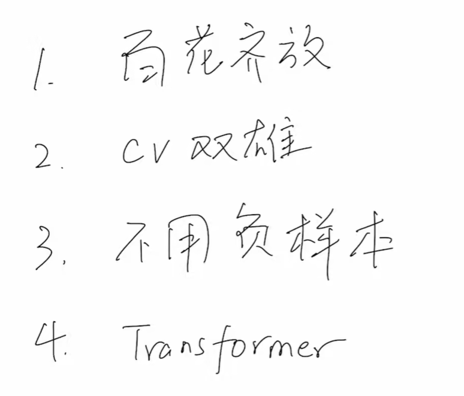

代表论文：

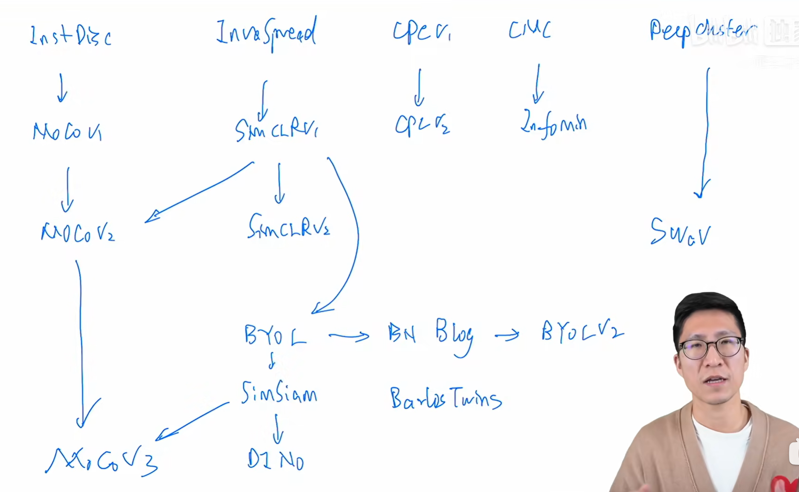

**走马观花看一遍**，只能在下面简要记录部分论文的大概贡献

step1：

InstDisc提出个体判别任务，并且用memory bank记录字典

InvaSpread使用端到端的模型架构

CPCv1提出一种预测性架构

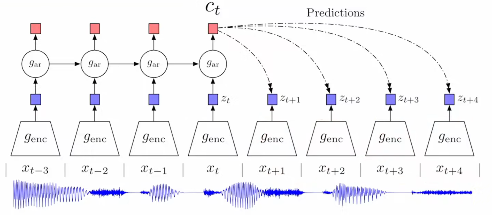

提取前几时刻的数据输出预测值，把未来几时刻的值当正样本，前几时刻的当负样本

CMC用一张图片的不同view当正样本

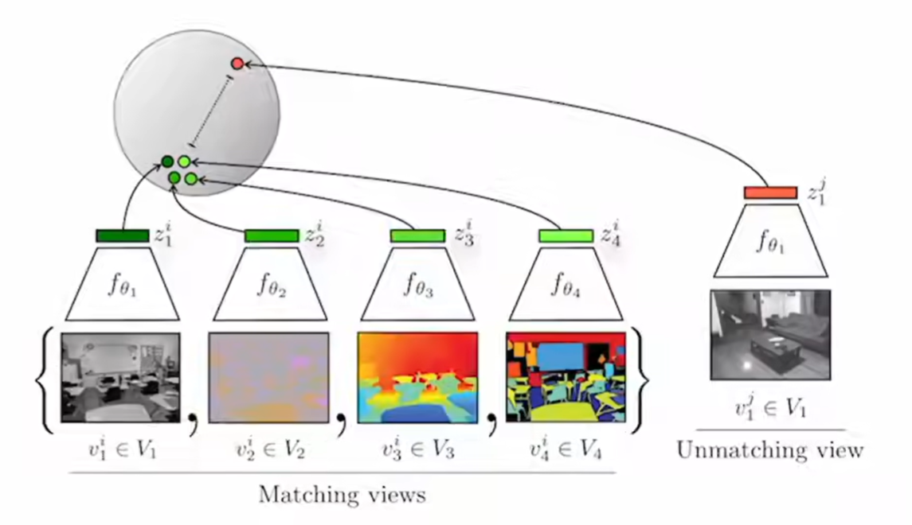

deepcluster使用聚类学习

step2：

MOCO在InstDisc上改进，引入队列和动量编码器

simCLRv1在InvaSpread基础上引入更多的图像增强技术，并且引入一个projector（一个简单的MLP层）

CPCv2在CPCv1上加了上面的各种新方法

CMC提出info min的原则，两个正样本之间的互信息要不大不小，保持合适

MOCOv2在MOCO上引入simCLRv1的技术

simCLRv2在simCLRv1上增大模型大小，加大projector层数（变成两层）

SWAV把聚类学习和对比学习结合起来

step3：

BYOL去除负样本，自己的一个视角预测自己的另外的一个视角（比较图中的$q_{\theta}(z_{\theta})$与$sg(z_{\xi}^{'})$）

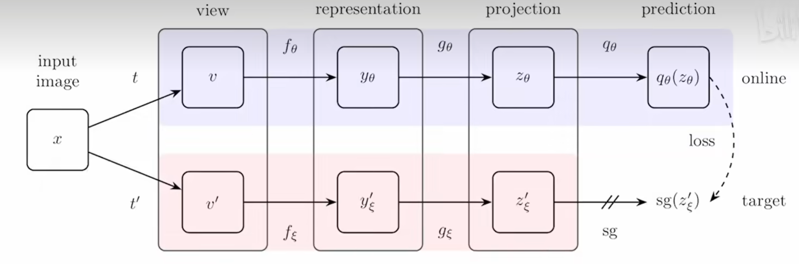

step4：

MOCOv3和DINO在vision transform基础上提出方法解决问题

### 问题回答

#### question1

有道理

上面的感知损失变体的目标：拉近清晰图，远离原下雨图，虽然看上去与对比学习“拉近正样本、推远负样本”的核心思想一致，但是在现在的语境中标准的对比学习不只是**拉近正样本、推远负样本**的核心思想，还要有还要有：

1. **自监督**来构建样本

   标准对比学习是不需要人工标签的，它靠数据增强（旋转、裁剪、变色）自己造正样本，靠 batch 里的其他人造负样本，而这里使用了有明确物理意义的监督数据

2. **更新编码器**

   标准的对比学习目的是训练特征提取器，这里的特征提取器被冻结了，本身不参与更新，只是靠它的特征提取能力做下游任务

3. **包含1个正样本和多个负样本，在集合中把正样本挑出来**，也就是相当于类别预测，衡量的是对于类别的概率分布，而不是简单的余弦相似度的差

#### question2

对比学习的视角下这是比较**同一张图三个不同状态**（rainy，derainy，clean）

锚点是derainy，正样本是clean，负样本是rainy

loss相当于一个“推开负样本，拉近正样本”的简单三元对比损失

也可以理解为一个正样本和一个负样本的极小字典

#### question3

选择1

```python
class InfoNCEContrastiveLoss(nn.Module):
    def __init__(self, tau=0.07, include_rainy=True, center=False):
        super().__init__()
        self.tau = tau
        vgg = vgg19(weights=VGG19_Weights.IMAGENET1K_V1).features.eval()
        self.register_buffer("mean", torch.tensor([0.485, 0.456, 0.406]).view(1, 3, 1, 1))
        self.register_buffer("std", torch.tensor([0.229, 0.224, 0.225]).view(1, 3, 1, 1))
        self.model = vgg[:35]
        for p in self.model.parameters():
            p.requires_grad = False
        self.pool = nn.AdaptiveAvgPool2d(1)
    prepare = EasyContrastiveLoss.prepare

    def forward(self, generated, rainy, truth):
        q = self.prepare(generated)           
        k_truth = self.prepare(truth)         
        k_rainy = self.prepare(rainy)
        # 这里用truth和rainy当字典，一个正样本，2N-1个负样本
        keys = (torch.cat([k_truth, k_rainy], dim=0))        
        logits = q @ keys.t() / self.tau                     
        labels = torch.arange(q.size(0), device=q.device)    
        return F.cross_entropy(logits, labels)
```

同时在main函数提供命令行参数选择ContrastiveLoss：

```python
parser.add_argument("--contrastive_loss",type=str,default="InfoNCE", choices=["InfoNCE","Easy"],help="EasyContrastiveLoss or InfoNCEContrastiveLoss")
```

在main里面条件判断：

```python
    if args.use_contrastive_loss:
        if args.contrastive_loss == "InfoNCE":
            contrastive_loss_fn = InfoNCEContrastiveLoss().to(device)
        elif args.contrastive_loss == "Easy":
            contrastive_loss_fn = EasyContrastiveLoss().to(device)
    else:
        contrastive_loss_fn = None
```

简单跑个50轮：

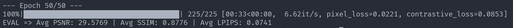

测试：

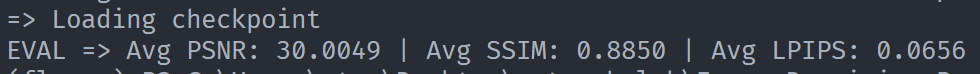


